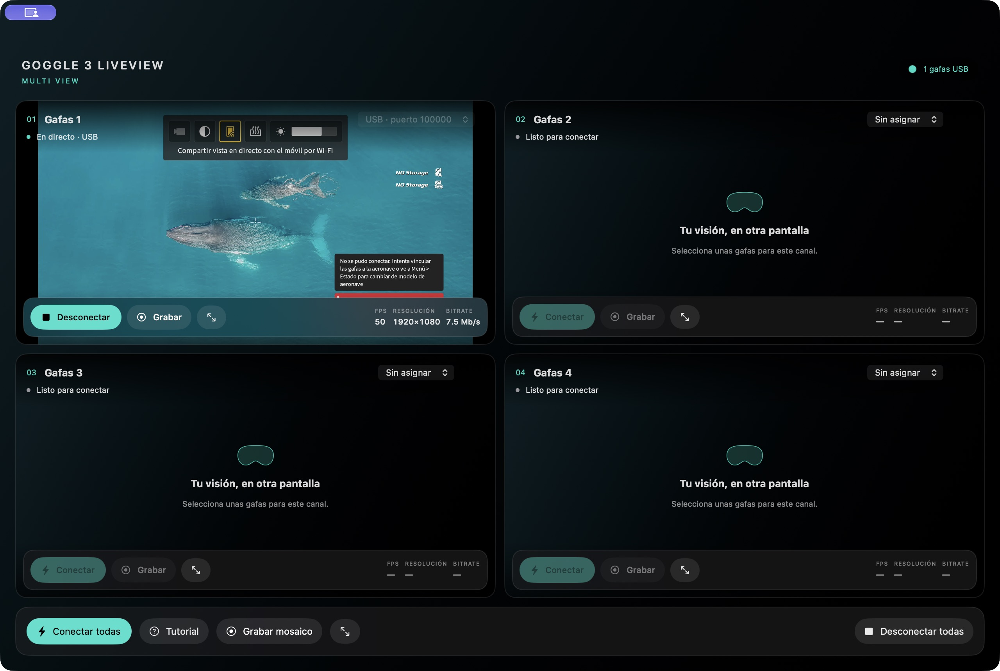

# Goggle 3 LiveView Multi

Cuatro espacios de vídeo, controles independientes y grabación del mosaico en una sola ventana.

**Aplicación independiente de Goggle 3 LiveView 0.3.1.** [Descargar Multi para Mac](https://github.com/knpuma/goggle-3-liveview/releases/download/multi-v0.4.0/Goggle-3-LiveView-Multi-Mac.dmg) · [Ver las dos aplicaciones](https://knpuma.github.io/goggle-3-liveview/).



## Instalar en Mac

Requiere Apple Silicon y macOS 14 o posterior. Abre el DMG y arrastra **Goggle 3 LiveView Multi** a **Aplicaciones**. Puede convivir con Goggle 3 LiveView; cierra el visor original antes de usar las mismas gafas en Multi.

La aplicación tiene firma local y no está notarizada por Apple. Comprueba su procedencia. No es necesario desactivar las protecciones globales del Mac.

## Preparar cada DJI Goggles 3

1. Enciende las gafas y conecta un cable USB de datos al Mac.
2. Activa **Configuración → Acerca de → Conexión por cable OTG**.
3. En los accesos directos —botón 5D hacia atrás— activa **Compartir la vista en directo con el dispositivo móvil por Wi-Fi**. El vídeo de esta app llega por USB; no necesitas conectar el Mac a ese Wi-Fi.
4. Para visualizar la pantalla sin aeronave vinculada, mantén habilitada **Grabación de la vista de cámara**, en **Configuración → Cámara → Configuración avanzada de la cámara**.
5. Elige el puerto USB en un panel y pulsa **Conectar**. Para más gafas, usa un cable y un puerto diferente por dispositivo. Puedes nombrar cada panel.

Cada selector muestra solo las gafas libres y las asignadas a ese mismo panel. Para mover unas gafas a otro panel, pulsa **Desconectar** y elige **Sin asignar** en el panel original; entonces estarán disponibles en los demás. Desconectar detiene el vídeo, pero conserva la asignación hasta que la liberes.

Los nombres de los ajustes se recogen en el [manual oficial DJI Goggles 3](https://dl.djicdn.com/downloads/DJI_Goggles_3/20240528/DJI_Goggles_3_User_Manual_ES.pdf). La combinación necesaria para recibir la pantalla sin aeronave se basa en la comprobación con las gafas conectadas; no es una garantía de DJI para esta aplicación independiente.

## Grabar y ampliar la imagen

- **Grabar**, en un panel: guarda solo esa imagen en un MP4 de 1920×1080.
- **Grabar mosaico**, en la barra inferior: guarda los cuatro paneles en un MP4 de 1920×1080, aproximadamente a 30 fps. Los canales sin señal quedan negros.
- Puedes grabar canales individuales y mosaico a la vez. Esto aumenta la carga del equipo.
- Los vídeos, sin audio, se guardan en **Películas/Goggle 3 LiveView Multi**. Pulsa **Detener** y espera a la confirmación de guardado.
- El icono junto a cada botón de grabar abre la imagen correspondiente a pantalla completa sin controles. **Esc** vuelve a la ventana. Ampliar un panel no altera el mosaico grabado.

**FPS** indica fotogramas decodificados por segundo, no la frecuencia del panel de las gafas. Al situar el puntero sobre el contador puedes consultar también los fotogramas presentados. El bitrate es el recibido por la app; no es el bitrate del enlace de radio.

## Si no aparece imagen

Comprueba el cable de datos, OTG y la vista en directo. Cierra otros visores que utilicen las mismas gafas. Desconecta el canal en la app, desactiva y vuelve a activar la vista en directo en las gafas y vuelve a conectar. Si has desenchufado el cable, selecciona de nuevo el puerto en el panel.

Utiliza las gafas como pantalla principal para pilotar. La aplicación no modifica el firmware ni envía las grabaciones a Internet.

Código MIT. FFmpeg conserva su licencia LGPL 2.1 o posterior; se incluyen sus avisos y el código fuente correspondiente. Aplicación independiente, no afiliada a DJI.

## Comunicar un fallo

[Notifica cualquier error en GitHub](https://github.com/knpuma/goggle-3-liveview/issues/new?template=multi-error.yml). Incluye la versión de Multi, tu Mac y macOS, el número de gafas, si usas un hub y los pasos para reproducirlo. Elimina datos privados y números de serie de las capturas.

## Construir desde el código

Desde esta carpeta, con Swift 6 y las herramientas de desarrollo de Apple:

```sh
swift test
./script/build_and_run.sh --build-only
```

El resultado es `dist/Goggle 3 LiveView Multi.app`. La compilación release no incluye vídeos de muestra ni menús de desarrollo. La fuente exacta de FFmpeg 8.0.3 y su licencia se adjuntan a la release; consulta [THIRD_PARTY_NOTICES.md](THIRD_PARTY_NOTICES.md).
