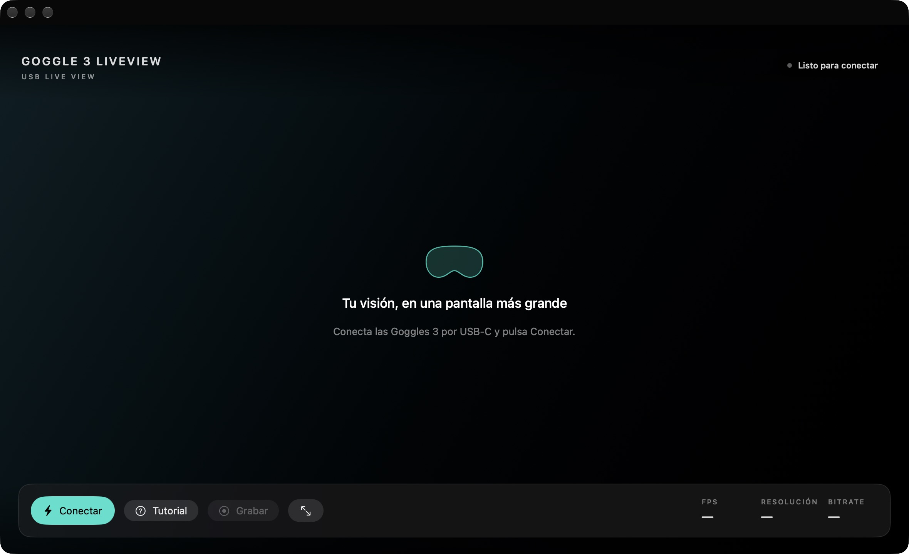
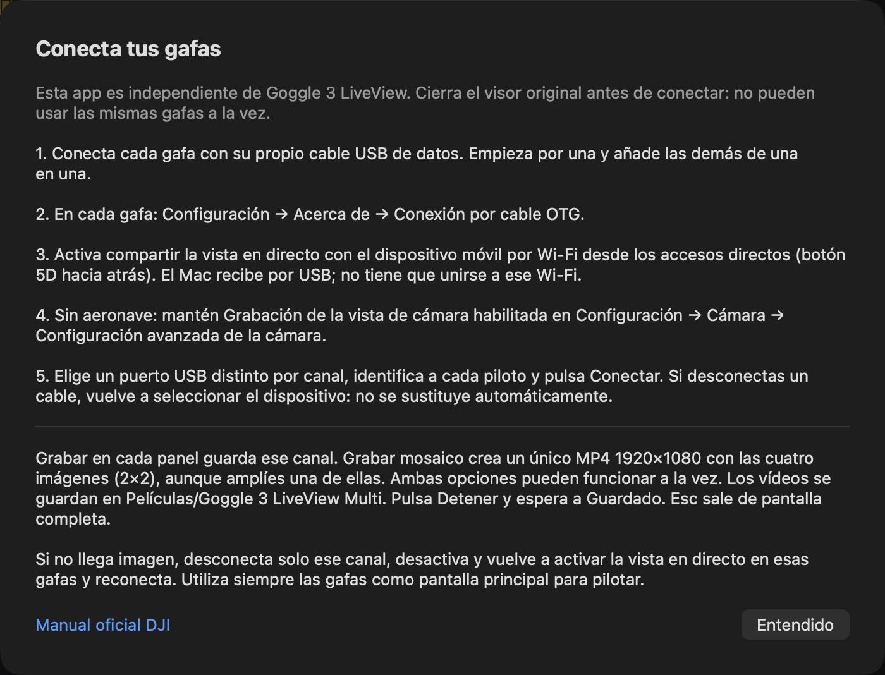

<p align="center"></p>

# Goggle 3 LiveView

### La pantalla de tus DJI Goggles 3, en tu ordenador.

Visor gratuito y de código abierto para **Mac y Windows**. Conecta las gafas por USB, ve su imagen en una ventana o a pantalla completa y guarda un vídeo en tu equipo. **Sin RC Pro. Sin suscripciones.**

[**Descargar la app**](https://knpuma.github.io/goggle-3-liveview/#descargar) · [**Instalación y ayuda**](https://knpuma.github.io/goggle-3-liveview/#instalar) · [Reportar un problema](https://github.com/knpuma/goggle-3-liveview/issues)

## Dos aplicaciones independientes

| Aplicación | Para qué sirve | Disponible para |
|---|---|---|
| **Goggle 3 LiveView 0.3.1** | Una gafa, una imagen y grabación individual | Mac Apple Silicon y Windows |
| **[Goggle 3 LiveView Multi 0.4.0](https://knpuma.github.io/goggle-3-liveview/#multi)** | Hasta cuatro canales USB, mosaico 2×2 y grabación individual o global | Mac Apple Silicon |

**Multi no sustituye ni actualiza la app original.** Puedes instalar ambas; cierra una antes de usar las mismas gafas en la otra. Tienen nombres y carpetas de grabación separados.



## Goggle 3 LiveView · una gafa

| Tu equipo | Archivo |
|---|---|
| Mac con chip Apple M1 o posterior, macOS 14+ | [Mac · DMG](https://github.com/knpuma/goggle-3-liveview/releases/download/v0.3.1/Goggle-3-LiveView-Mac-Apple-Silicon.dmg) |
| Windows 11 con procesador Intel o AMD | [Windows · x64 ZIP](https://github.com/knpuma/goggle-3-liveview/releases/download/v0.3.1/Goggle-3-LiveView-Windows-x64.zip) |
| Windows 11 con procesador ARM, por ejemplo Snapdragon | [Windows · ARM64 ZIP](https://github.com/knpuma/goggle-3-liveview/releases/download/v0.3.1/Goggle-3-LiveView-Windows-arm64.zip) |

**Mac:** abre el DMG y arrastra la app a Aplicaciones. **Windows:** extrae todo el ZIP y abre `Goggle 3 LiveView.exe`; conserva los demás archivos junto al ejecutable. No necesitas herramientas de desarrollo.

La distribución no tiene certificado comercial ni notarización de Apple. Si el sistema muestra un aviso, verifica que has descargado desde este repositorio y consulta la [guía de instalación](https://knpuma.github.io/goggle-3-liveview/#instalar). No desactives la protección global de tu equipo.

## Goggle 3 LiveView Multi · cuatro espacios de vídeo

**[Descargar Multi para Mac · DMG](https://github.com/knpuma/goggle-3-liveview/releases/download/multi-v0.4.0/Goggle-3-LiveView-Multi-Mac.dmg)** · [Guía de Multi](Multi/README.md) · [Archivos de esta versión](https://github.com/knpuma/goggle-3-liveview/releases/tag/multi-v0.4.0)

Requiere Apple Silicon y macOS 14 o posterior. Esta descarga es solo para Mac; la app original mantiene sus versiones de Mac y Windows.


- **Mosaico 2×2:** hasta cuatro canales con nombre, conexión, FPS, resolución y bitrate independientes.
- **Grabación individual y global:** guarda un canal o todo el mosaico en MP4. Puedes usar ambas opciones a la vez. El mosaico es 1920×1080, aproximadamente 30 fps, y mantiene su disposición aunque amplíes un panel.
- **Pantalla completa:** por canal o para el mosaico, sin controles. Esc vuelve a la ventana.
- **Tus archivos separados:** Películas → Goggle 3 LiveView Multi. Sin audio ni subidas a Internet.



**¿Encuentras un error o fallo? [Notifícalo aquí](https://github.com/knpuma/goggle-3-liveview/issues/new?template=multi-error.yml).** Indica versión, equipo, macOS, número de gafas y pasos para reproducirlo. No incluyas números de serie ni información privada.

## Conecta en cuatro pasos

1. **USB de datos.** Enciende las Goggles 3 y conéctalas al ordenador con un cable que permita transferencia de datos.
2. **Activa OTG.** En las gafas: Configuración → Acerca de → Conexión por cable OTG.
3. **Comparte LiveView.** Empuja el botón 5D hacia atrás y activa la opción de compartir la vista en directo con el dispositivo móvil por Wi-Fi. Aunque su nombre dice Wi-Fi, esta app utiliza ese ajuste para recibir por **USB**: no necesitas conectar el ordenador al Wi-Fi de las gafas.
4. **Pulsa Conectar.** En Windows, la primera conexión puede pedir permiso para preparar únicamente el adaptador de red USB de las gafas.

### ¿Quieres ver la pantalla sin un dron conectado?

Activa **Grabación de la vista de cámara** en Configuración → Cámara → Configuración avanzada de la cámara. Para este modo, mantén también OTG y la vista en directo compartida activados. Para ver una cámara de vuelo, sí necesitas que las gafas reciban su imagen de una aeronave o unidad de vídeo compatible.

Los nombres de los ajustes proceden del [manual oficial DJI Goggles 3](https://dl.djicdn.com/downloads/DJI_Goggles_3/20240528/DJI_Goggles_3_User_Manual_ES.pdf), páginas 24 y 28–31. La recepción de este proyecto por USB y el modo sin aeronave no son una función de esta app documentada o respaldada por DJI.

## Controles sencillos

- **Conectar / Desconectar:** abre o cierra la sesión con las gafas.
- **Tutorial:** consulta la configuración sin salir de la app.
- **Grabar / Detener:** guarda un MP4 en `Películas/Goggle 3 LiveView` (Mac) o `Vídeos/Goggle 3 LiveView` (Windows). Pulsa Detener para finalizarlo. Sin audio.
- **Pantalla completa:** icono junto a Grabar; oculta los controles y estadísticas. Esc vuelve a la ventana; Windows admite también F11.
- **FPS, resolución y bitrate:** describen la imagen que recibe el ordenador. El bitrate USB no es la velocidad del enlace radio del dron.

¿Se queda esperando imagen? Desconecta desde la app, desactiva y reactiva LiveView en las gafas y vuelve a conectar. Cierra otros visores que puedan ocupar el USB. Más soluciones en la [página de ayuda](https://knpuma.github.io/goggle-3-liveview/#ayuda).

## Para desarrolladores

macOS: SwiftUI, IOKit y un decodificador FFmpeg independiente. Windows: WPF/.NET y el controlador RNDIS de Microsoft. El código no modifica firmware ni envía órdenes de vuelo. La app no sube vídeo a Internet.

```sh
# macOS — Swift 6 y herramientas de desarrollo de Apple
swift build
swift test
zsh scripts/make-app.sh
open "outputs/Goggle 3 LiveView.app"
```

[Construcción de Windows](Windows/README.md) · [Componentes y fuentes de terceros](THIRD_PARTY_NOTICES.md)

La app Multi tiene su propio proyecto Swift en [Multi/](Multi/README.md), separado de los targets de la app original y publicado también bajo MIT.

Los nombres históricos de algunos módulos y el identificador interno se conservan por compatibilidad. Las grabaciones antiguas de Goggles3Mac permanecen en su carpeta original.

## Licencia y comunidad

Código del proyecto bajo [licencia MIT](LICENSE). FFmpeg se distribuye como programa separado bajo LGPL 2.1 o posterior; sus fuentes y licencias acompañan a la distribución. Los componentes .NET conservan sus propias licencias.

Proyecto independiente de la comunidad, no afiliado ni respaldado por DJI. DJI y Goggles son marcas de sus respectivos titulares. Utiliza el visor con responsabilidad; no sustituye a la vista principal del piloto.

Para pedir ayuda, abre un issue con el sistema operativo, arquitectura, firmware de las gafas, pasos y mensaje de error. **No publiques números de serie ni datos privados.**
