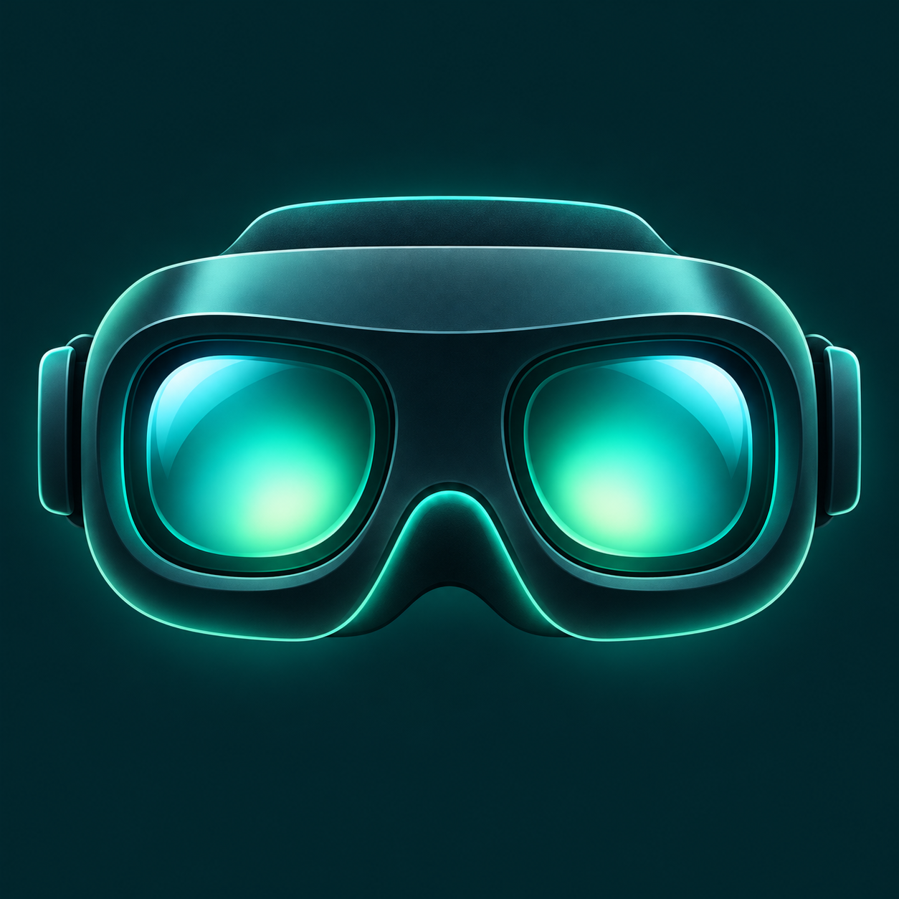
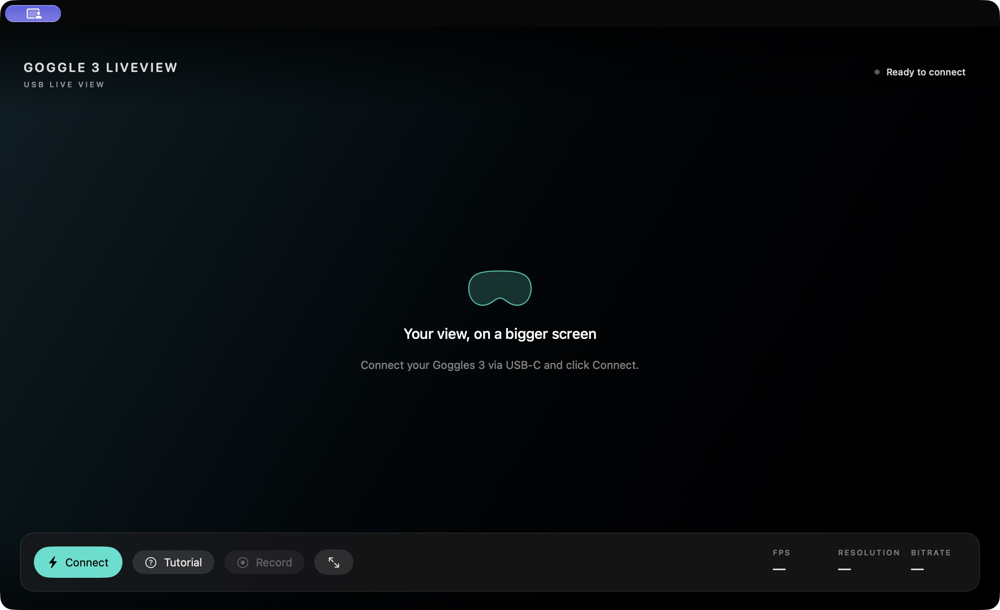
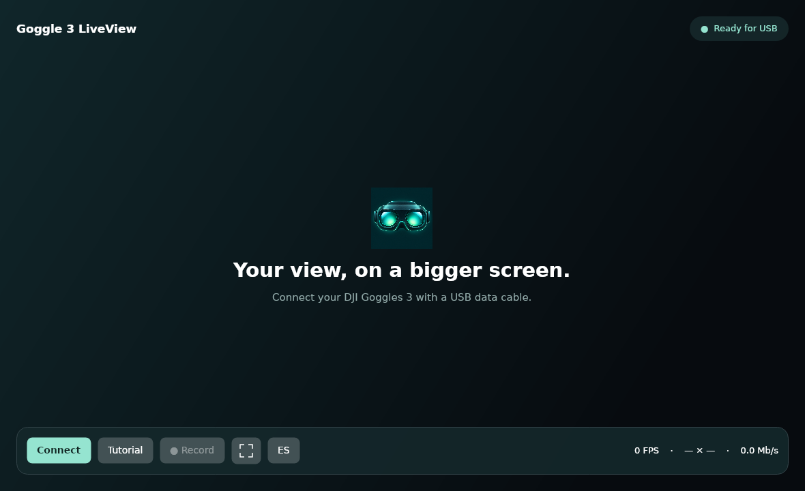
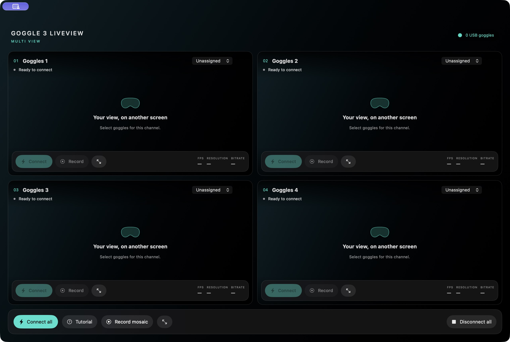
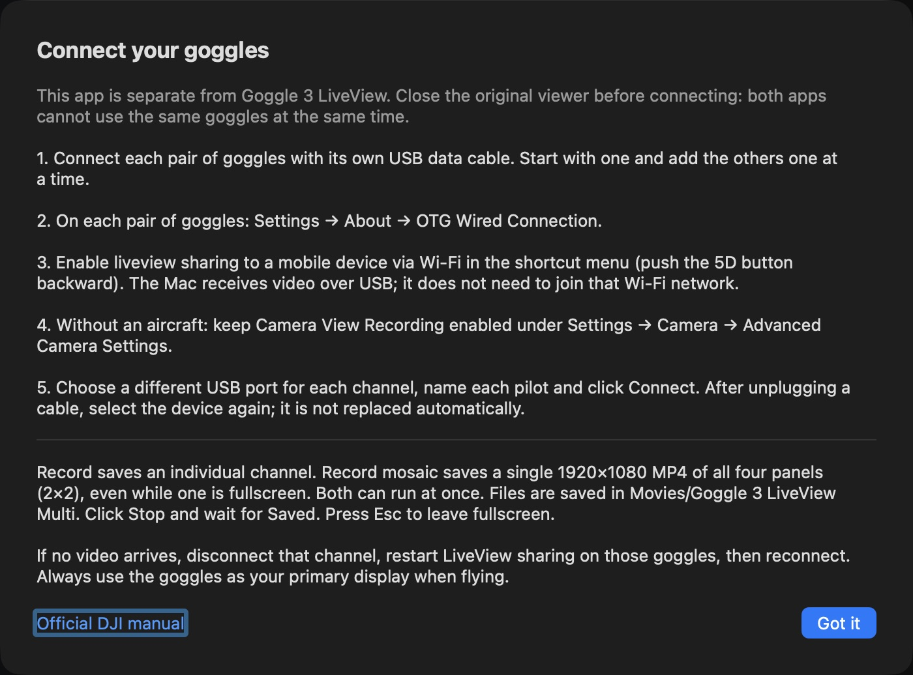

<p align="center"></p>

# Goggle 3 LiveView

### Your DJI Goggles 3 screen, on your computer.

Free, open-source USB viewers for **Mac, Windows and Linux**. Watch the goggles feed in a window or fullscreen and record video locally. **No RC Pro. No subscriptions.**

[**Downloads & setup guide**](https://knpuma.github.io/goggle-3-liveview/) · [Report an issue](https://github.com/knpuma/goggle-3-liveview/issues)

## Choose your viewer

| Application | What it does | Platforms |
|---|---|---|
| **Goggle 3 LiveView** | One pair of goggles, one feed and MP4 recording | Mac / Windows 0.3.2; Linux x64 preview 0.3.3 |
| **Goggle 3 LiveView Multi** | Up to four USB channels, a 2×2 mosaic, individual and global MP4 recording | Apple Silicon Mac / Windows x64 |

Close other viewers before connecting to the same goggles.

## Download the original viewer



| Computer | English | Español |
|---|---|---|
| Mac · Apple M1 or later · macOS 14+ | [DMG](https://github.com/knpuma/goggle-3-liveview/releases/download/v0.3.2/Goggle-3-LiveView-Mac-Apple-Silicon-English.dmg) | [DMG](https://github.com/knpuma/goggle-3-liveview/releases/download/v0.3.1/Goggle-3-LiveView-Mac-Apple-Silicon.dmg) |
| Windows 11 · Intel / AMD x64 | [ZIP](https://github.com/knpuma/goggle-3-liveview/releases/download/v0.3.2/Goggle-3-LiveView-Windows-x64-English.zip) | [ZIP](https://github.com/knpuma/goggle-3-liveview/releases/download/v0.3.1/Goggle-3-LiveView-Windows-x64.zip) |
| Windows 11 · ARM64 | [ZIP](https://github.com/knpuma/goggle-3-liveview/releases/download/v0.3.2/Goggle-3-LiveView-Windows-arm64-English.zip) | [ZIP](https://github.com/knpuma/goggle-3-liveview/releases/download/v0.3.1/Goggle-3-LiveView-Windows-arm64.zip) |
| Linux · Intel / AMD x64 · tested only on Ubuntu 24.04 | [DEB](https://github.com/knpuma/goggle-3-liveview/releases/download/v0.3.2/Goggle-3-LiveView-Linux-x64-0.3.3.deb) · [Portable](https://github.com/knpuma/goggle-3-liveview/releases/download/v0.3.2/Goggle-3-LiveView-Linux-x64-0.3.3.tar.gz) | Included in the same download · ES / EN switch |

**Package versions:** Mac/Windows English 0.3.2; Spanish 0.3.1; Linux 0.3.3 with both languages included.

**Mac:** open the DMG and drag the app to Applications. **Windows:** extract the entire ZIP and open **Goggle 3 LiveView.exe**, keeping all other files beside it. No developer tools or separate .NET installation are needed.

The apps do not have a commercial signing certificate; Mac packages are not notarized by Apple. Verify the download source and follow the [first-launch instructions](https://knpuma.github.io/goggle-3-liveview/#instalar). Do not disable system-wide security protections.

### Linux installation

**[Ubuntu 24.04 · .deb installer](https://github.com/knpuma/goggle-3-liveview/releases/download/v0.3.2/Goggle-3-LiveView-Linux-x64-0.3.3.deb)** · **[Portable .tar.gz](https://github.com/knpuma/goggle-3-liveview/releases/download/v0.3.2/Goggle-3-LiveView-Linux-x64-0.3.3.tar.gz)** · [Linux setup guide](Linux/README.md) · [Guía en español](Linux/README.es.md)

**Linux 0.3.3 · English and Spanish in one app. Tested only on Ubuntu 24.04 x64. Other Linux distributions have not been tested.** X11 or XWayland is required. Connect directly over USB, record MP4 locally and use clean fullscreen. The .NET runtime is included; FFmpeg comes from your distribution.

```sh
sudo apt install ./Goggle-3-LiveView-Linux-x64-0.3.3.deb
```



Linux builds, package installation, UI, protocol loopback, decoding and MP4 recording are checked automatically. Physical Goggles 3 reception on Linux still needs community feedback; report problems through [GitHub issues](https://github.com/knpuma/goggle-3-liveview/issues).

## Download Multi

**[Multi for Mac · English · 0.4.1](https://github.com/knpuma/goggle-3-liveview/releases/download/multi-v0.4.1/Goggle-3-LiveView-Multi-Mac-English.dmg)** · **[Español · 0.4.0](https://github.com/knpuma/goggle-3-liveview/releases/download/multi-v0.4.0/Goggle-3-LiveView-Multi-Mac.dmg)** · [Multi guide](Multi/README.md)

**[Multi for Windows x64 · 0.5.0 · English / Español](https://github.com/knpuma/goggle-3-liveview/releases/download/multi-v0.5.0/Goggle-3-LiveView-Multi-Windows-x64-0.5.0.zip)** · [Windows guide](Windows/Multi-README.md) · [Guía en español](Windows/Multi-LEEME.md)

**Mac:** Apple Silicon, macOS 14 or later. **Windows:** Windows 11 x64 or Windows 10 22H2 x64. Extract the entire ZIP and open **Goggle 3 LiveView Multi.exe**. The runtime and encoder are included; use **ES / EN** to change language.



- **2×2 mosaic:** up to four named channels, with independent connection and video statistics.
- **Individual and global recording:** save a channel or the entire mosaic, or both at once. Mosaic recording is 1920×1080 at approximately 30 fps.
- **Clean fullscreen:** one channel or the complete mosaic. Press Esc to return.
- **Local files:** Movies → Goggle 3 LiveView Multi on Mac; Videos → Goggle 3 LiveView Multi on Windows. No audio or Internet uploads.



**Language editions:** Mac apps and the original Windows viewer have separate English and Spanish downloads. Multi for Windows and the Linux viewer include an **ES / EN** switch in the app.

## Connect in four steps

1. **USB data cable.** Power on the Goggles 3 and connect them to your computer.
2. **Enable OTG.** On the goggles: Settings → About → **OTG Wired Connection**.
3. **Share LiveView.** Push the 5D button backward and enable liveview sharing to a mobile device via Wi-Fi. Despite the setting’s name, this app receives video over **USB**; your computer does not need to join the goggles Wi-Fi network.
4. **Click Connect.** On Windows and Linux, the first connection may request administrator permission to configure only the goggles USB network adapter. Follow the [Linux guide](Linux/README.md) for its driver and network requirements.

### Without a linked aircraft

Keep **Camera View Recording** enabled under Settings → Camera → Advanced Camera Settings, along with OTG and LiveView sharing. To show a flight camera, the goggles must receive its signal from a compatible aircraft or air unit.

Setting names follow the [official DJI manual](https://dl.djicdn.com/downloads/DJI_Goggles_3/DJI_Goggles_3_User_Manual_EN.pdf). USB reception by this app and operation without an aircraft are independent project features, not functions documented or endorsed by DJI for this application.

## Controls and recording

**Connect / Disconnect** opens or closes the session. **Tutorial** shows setup instructions. **Record / Stop** saves a silent MP4 in Movies → Goggle 3 LiveView on Mac or Videos → Goggle 3 LiveView on Windows and Linux. Wait for saving to finish before quitting.

The fullscreen icon is beside Record. **Esc** returns to the window; Windows and Linux also support **F11**. FPS, resolution and bitrate describe the video processed by the computer, not the aircraft radio link. Linux displays its scaled preview size, 1920×1080.

If the app waits for video, disconnect, restart LiveView sharing on the goggles and reconnect. Close other apps using the goggles USB device. See the [help page](https://knpuma.github.io/goggle-3-liveview/#ayuda).

## Build from source

macOS uses SwiftUI, IOKit and a separate FFmpeg decoder. Windows uses WPF/.NET and Microsoft’s RNDIS driver. Linux uses Avalonia/.NET, the kernel's RNDIS/USB network driver and system FFmpeg. The apps do not modify firmware, send flight commands or upload video.

With Swift 6 and Apple developer tools:

```sh
swift build
swift test
zsh scripts/make-app.sh
open "outputs/Goggle 3 LiveView.app"
```

[Windows build guide](Windows/README.md) · [Linux build guide](Linux/README.md#build) · [Multi project and build guide](Multi/README.md) · [Third-party notices](THIRD_PARTY_NOTICES.md)

Historical internal module names and identifiers are retained for compatibility. Older Goggles3Mac recordings stay in their original folder.

## License and support

Project code is licensed under [MIT](LICENSE). Mac/Windows FFmpeg is distributed as a separate program under LGPL 2.1 or later, with matching source and license notices. Linux packages do not redistribute FFmpeg; they use the distribution's executable. .NET and UI components retain their own licenses.

Independent community project, not affiliated with or endorsed by DJI. DJI and Goggles are trademarks of their respective owners. Always use the goggles as your primary display when flying.

[Report a Multi problem](https://github.com/knpuma/goggle-3-liveview/issues/new?template=multi-error.yml) or [ask for help](https://github.com/knpuma/goggle-3-liveview/issues). Include your app version and language, computer, operating system, goggles firmware and reproduction steps. **Do not post serial numbers or private information.**
